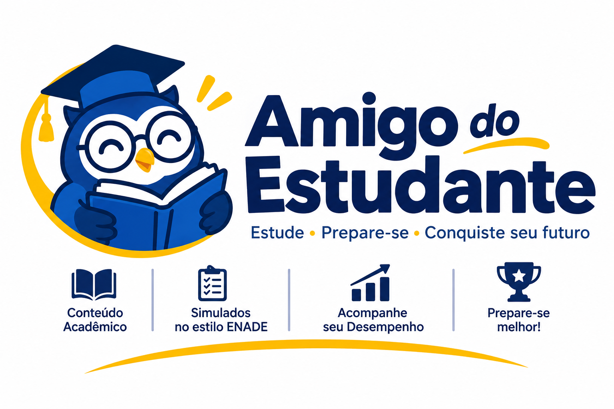

<div align="center">
  
</div>
# 📚 Amigo do Estudante: Aprenda e Conquiste

> Repositório oficial do **Grupo 2** para a disciplina de **Engenharia de Requisitos (2026.2)**.

---

## 📖 Sobre o Projeto

O **Amigo do Estudante: Aprenda e Conquiste** é uma solução voltada para auxiliar estudantes em sua jornada acadêmica, promovendo organização, engajamento e melhoria no desempenho escolar/universitário. 

Este repositório reúne todos os artefatos produzidos ao longo da disciplina de Engenharia de Requisitos, incluindo elicitação, análise, especificação, validação e gerenciamento de requisitos.

---

## 🎯 Objetivos

- **Centralizar** os artefatos de Engenharia de Requisitos do projeto.
- **Documentar** o processo de descoberta e definição das necessidades dos usuários (estudantes).
- **Rastrear** a evolução dos requisitos funcionais e não funcionais ao longo do semestre 2026.2.

---

## 📂 Estrutura do Repositório

```text
Requisitos-2026.2-Grupo2/
├── docs/                                         # Documentação detalhada e artefatos de requisitos
│   ├── 01-planejamento/                          # Cronograma, metodologia e plano de ação
│   ├── 02-elicitacao/                            # Entrevistas, questionários, brainstorming e personas
│   ├── 03-analise/                               # Priorização (MoSCoW), regras de negócio e modelagem
│   ├── 04-especificacao/                         # Histórias de usuário, casos de uso e protótipos
│   └── 05-validacao/                             # Checklists, revisões e atas de validação
├── assets/                                       # Imagens, diagramas e recursos visuais
├── Amigo_do_Estudante_ Aprenda_e_Conquiste.png   # Imagem de capa do projeto
└── README.md                                     # Apresentação geral do repositório
```

*(Nota: Ajuste os nomes das pastas acima conforme a organização atual do seu repositório).*

---

## 🛠️ Metodologias e Ferramentas Utilizadas

- **Elicitação e Análise:** Brainstorming, Entrevistas, Personas, Mapa de Empatia, Técnica MoSCoW.
- **Especificação:** Histórias de Usuário (User Stories), Critérios de Aceitação (BDD/Gherkin), Diagramas de Casos de Uso.
- **Prototipação:** Figma / Canva.
- **Versionamento e Gestão:** Git, GitHub, GitHub Projects / Trello.

---

## 👥 Equipe — Grupo 2

| Foto | Nome | GitHub | Papel / Contribuição |
| :---: | :--- | :--- | :--- |
| 👤 | **Ian Cirino** | [@IanCirino](https://github.com/IanCirino) | Integrante / Engenharia de Requisitos |
| 👤 | *Nome do Integrante 2* | [@usuario2](https://github.com/) | Integrante / Engenharia de Requisitos |
| 👤 | *Nome do Integrante 3* | [@usuario3](https://github.com/) | Integrante / Engenharia de Requisitos |
| 👤 | *Nome do Integrante 4* | [@usuario4](https://github.com/) | Integrante / Engenharia de Requisitos |
| 👤 | *Nome do Integrante 5* | [@usuario5](https://github.com/) | Integrante / Engenharia de Requisitos |

---

## 📅 Cronograma e Entregas

- [x] **Etapa 1:** Formação do Grupo e Definição do Escopo
- [ ] **Etapa 2:** Elicitação de Requisitos e Definição de Personas
- [ ] **Etapa 3:** Análise, Priorização e Regras de Negócio
- [ ] **Etapa 4:** Especificação de Requisitos e Prototipação
- [ ] **Etapa 5:** Validação e Entrega Final

---

## 📄 Licença

Este projeto é desenvolvido para fins estritamente acadêmicos no âmbito da disciplina de Engenharia de Requisitos (2026.2).